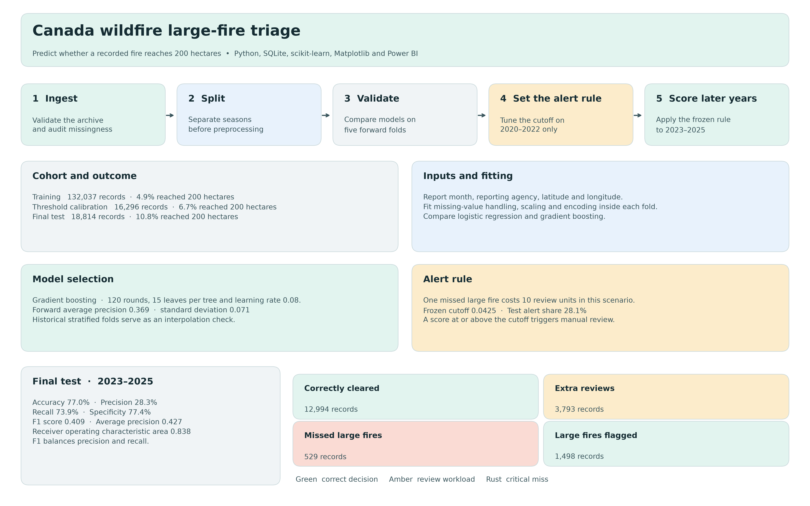

# Canada Wildfire Intelligence & Large-Fire Triage

[](https://www.python.org/)
[](dashboard/README.md)
[](modeling/README.md)


## How many extra reviews would it take to flag one more large fire?

On **18,814 held-out Canadian wildfire records from 2023–2025**, moving from the 10× to the 20× alert rule flagged **136 more large fires** and generated **1,275 more reviews**. That's about **9.4 extra reviews per additional large fire flagged**.

| Held-out result | 10× rule | 20× rule |
| --- | ---: | ---: |
| Records sent for review | 5,291 | 6,566 |
| Large fires flagged | 1,498 | 1,634 |
| Large fires missed | 529 | 393 |

A large fire is a record whose final area reached **200 hectares**. The multipliers express how heavily each rule weighs a miss relative to an unnecessary review. The results give teams a historical workload comparison they can weigh against their review capacity.

I also tested a simpler lookup based on past large-fire rates by reporting agency and month. At the same **5,291 reviews**, the lookup flagged **1,334** large fires and the model flagged **1,498**. [Baseline method and results](#agency-by-month-baseline)

[Portfolio case study and audited Power BI screenshots](https://mamkon.github.io/wildfire-triage/) · [Alert rules and evaluation data](modeling/results/test_policies.csv)

The historical analysis covers **168,276 records from 12 reporting agencies across 2000–2025**. This repository includes the [historical research Power BI project](dashboard/README.md), a separate report from the audited dashboard shown in the portfolio.

## Predictive triage architecture

[](modeling/assets/pipeline_workflow.png)

I trained on **2000–2019** (132,037 records), chose the cutoff on **2020–2022** (16,296 records), and tested the frozen rule on **2023–2025** (18,814 records). Gradient boosting averaged **0.369** average precision over five forward validation folds, with a standard deviation of **0.071**. The inputs were report month, reporting agency, latitude, and longitude. Missing-value handling, coordinate scaling, and one-hot encoding were fitted inside each training fold.

I treated one missed large fire as equivalent to ten extra reviews in the calibration scenario. The resulting score cutoff was **0.0425** when rounded for display. It was fixed before testing. The archive does not establish whether those inputs were available and unchanged at first dispatch, so this evaluation supports retrospective planning discussions.

## Held-out performance

| Metric | Result | What it measures |
| --- | ---: | --- |
| Area under the receiver operating characteristic curve | 0.838 | How well the scores rank records that reached 200 hectares above smaller fires. |
| Recall (sensitivity) | 73.9% | Share of fires that reached 200 hectares that the rule flagged. |
| Precision | 28.3% | Share of flagged records that reached 200 hectares. |
| Specificity | 77.4% | Share of fires below 200 hectares that the rule cleared. |
| Manual review share | 28.1% | Share of all test records the rule would send for review. |

| Final recorded size | Cleared by the rule | Flagged for review |
| --- | ---: | ---: |
| Below 200 hectares | 12,994 correctly cleared | 3,793 extra reviews |
| At least 200 hectares | **529 missed large fires** | 1,498 large fires flagged |

[Threshold comparisons and reproduction steps](modeling/README.md#asymmetric-error-and-decision-boundary-stress-test) · [Evaluation results](modeling/results/evaluation.json)

## What I found

| Finding | How I would use it |
| --- | --- |
| The largest 3% of records account for **59% to over 99%** of recorded area within individual agencies. | Review large-event capacity by agency. A pooled national threshold can hide substantial differences in local workload. |
| **July** has the most records with a known report month, at **42,235**. | Use July as a starting point for national seasonal planning, then check individual agency calendars before setting staffing or outreach dates. |
| Natural/lightning causes account for **46% of records and 87% of area**. Human causes account for **49% of records and 8% of area**. | Track the frequency of recorded incidents and the scale of large events separately. They answer different planning questions. |
| Mean annual area for 2020–2025 falls from **6.26 million ha** to **3.99 million ha** when 2023 is removed. | Compare ordinary-year and extreme-year capacity needs. The periods are unequal and reporting changes limit the comparison. |

Agencies record small fires differently. I checked how often each agency records exactly 0, 0.01, and 0.1 ha before comparing typical sizes. Counts refer to database records. Area sums reported sizes and can include overlapping land. The analysis describes historical reporting and provides no forecast of seasonal fire probability.

## How I built it

| Tool | Role in the project |
| --- | --- |
| **Python** | Profiled the source data, preserved exclusion flags, independently checked the SQL results, and produced the notebooks and charts. |
| **Structured Query Language (SQL) / SQLite** | Built the fact and dimension tables and calculated annual totals, seasonal counts, cause shares, and recording checks. |
| **Power BI Desktop** | The historical research project has 13 report pages, including Executive Summary, Concentration, Trust, Change, Cause, and Northwest Territories response classification. |
| **Excel** | Packaged summary tables and denominator checks for spreadsheet review. |

Open the [Power BI project](dashboard/Canada_Wildfire.pbip) in Desktop after cloning or downloading the repository. Keep the two project folders beside the project shortcut. Select **Refresh now** if Desktop prompts you to load the embedded summaries. [Build guide](powerbi/BUILD_GUIDE.md)

## Repository structure

```text
.
├── dashboard/
│   ├── Canada_Wildfire.pbip
│   ├── Canada_Wildfire.Report/
│   │   ├── definition.pbir
│   │   ├── definition/              # Pages, visuals, and report.json
│   │   └── StaticResources/         # Themes and images
│   └── Canada_Wildfire.SemanticModel/
│       ├── definition.pbism
│       └── model.bim                # Local semantic model
├── modeling/
│   ├── assets/pipeline_workflow.png # Workflow and held-out scorecard
│   ├── data.py                      # Cohort checks and year splits
│   ├── diagram.py                   # Generate the workflow diagram
│   ├── run.py                       # Train, calibrate, and score held-out years
│   ├── evaluation.py                # Threshold selection and evaluation metrics
│   └── results/                     # Evaluation record and aggregate exports
├── notebooks/                      # Data-quality and historical burden analysis
├── sql/                            # SQLite warehouse and analysis queries
├── src/                            # Data preparation and Power BI build scripts
└── README.md
```

## Geospatial and semantic model architecture

The Power BI project shortcut (`.pbip`) opens the report. The report's `definition.pbir` links to the local semantic model using `byPath`. The report's `definition/` folder holds page and visual definitions. The GitHub model stores its Data Analysis Expressions (DAX) measures and Power Query M queries in `model.bim`.

| Report control | What it shows |
| --- | --- |
| **Azure Maps** | 168,069 records contribute to 1,121 rounded coordinate cells. Locations, heat and clusters show historical records at cell level. The province or territory and year dropdowns filter those views while the executive indicators retain the full study scope. |
| **Geographic assignment** | Original coordinates are matched to Natural Earth province and territory boundaries before rounding. The 2,275 plottable records without a boundary match appear as **Unassigned**. A separate 207 records have no plottable coordinates and are omitted from the maps. |
| **July benchmark** | The gauge shows **3.07×**. It divides 42,235 July records by the average of 13,738 records per calendar month across the study period. The **1×** marker represents that average. |
| **Area concentration** | The largest 3% of records account for **96.2%** of pooled recorded area. The agency-by-agency comparison ranges from 59% to over 99%. |
| **Cause coding** | The donut shows 160,515 records with a known cause and 7,761 with an unknown cause. The source provides no detection confidence score. |
| **Trust and reconciliation** | The full 2023 source-year count and rounded area match the national table in the 2025 annual report. The narrower analytical total remains **pending National Forestry Database reconciliation**. |
| **Forest Watch and Carbon Flux** | These pages describe the external forest-change and carbon datasets needed to support those views. |

[Dashboard opening instructions and proposed palette](dashboard/README.md) · [Natural Earth boundary data](https://www.naturalearthdata.com/downloads/50m-cultural-vectors/50m-admin-1-states-provinces/) · [Reconciliation notes](docs/reconciliation_report.md)

The Executive Summary layout draws on the [SAS Visual Analytics wildfire dashboard](https://communities.sas.com/t5/SAS-Visual-Analytics-Gallery/Fighting-the-Amazon-forest-fires-with-advanced-analytics/ta-p/784221). The Canadian boundary layer comes from [Natural Earth](https://www.naturalearthdata.com/about/terms-of-use/).

Start with the [data quality notebook](notebooks/01_data_quality_and_coverage.ipynb), then read the [burden analysis](notebooks/02_burden_patterns.ipynb). The [Excel workbook](Canada_Wildfire_Review.xlsx) provides the main figures in tables.

## Scope and validation

I used a fixed reporting-agency scope and excluded Prince Edward Island from the main window because its documented coverage starts later. Reporting agencies and geographic jurisdictions are distinct. The Northwest Territories view reports response classifications and includes unknown classifications in its denominators.

The full 2023 source-year count and area rounded to whole hectares match the 2025 annual report's published national table. The project's narrower scope excludes seven Prince Edward Island records and five Ontario records flagged as prescribed fires for that year. **Jurisdiction-by-year National Forestry Database reconciliation is pending.** [Reconciliation notes](docs/reconciliation_report.md)

## Reproduce the analysis

Run these commands from a terminal with Git and Python 3.12 available.

```sh
git clone https://github.com/mamkon/wildfire-seasonal-risk-research.git
cd wildfire-seasonal-risk-research
python -m pip install -r requirements.txt -r modeling/requirements.txt

# Prepare the data and build the SQLite warehouse
python -m src.download_data
python -m src.prepare_cnfdb
python -m src.load_warehouse

# Train, calibrate, and evaluate the triage model
python -m modeling.run --miss-cost 10

# Regenerate the workflow diagram from the evaluation results
python -m modeling.diagram
```

If you already have a reviewed SQLite warehouse, skip the three data preparation commands and pass its path with `python -m modeling.run --warehouse PATH_TO_WILDFIRE_DB --miss-cost 10`. The diagram command can also run on its own using the committed evaluation results.

To reproduce the historical analysis and refresh its Power BI exports, continue from the repository root.

```sh
python -m src.reconcile
make analysis
python -m src.export_powerbi
python -m pytest tests -q
```

On Windows without `make`, run the Python commands under `analysis` in the [Makefile](Makefile). The downloader expects the pinned release in [source_versions.csv](data/source_versions.csv) and verifies its SHA-256. If the provider replaces the current archive, place the matching pinned extract in `data/raw/` before running preparation. Raw inputs, generated row-level exports and the local database are excluded from Git.

The combined [Colab notebook](notebooks/03_colab_research_review.ipynb) contains saved outputs. Its interactive runtime path requires the separate review bundle with the built database and figures.

## Source and attribution

Canadian Forest Service. *Canadian National Fire Database: Agency Fire Data*. Natural Resources Canada, Canadian Forest Service, Northern Forestry Centre. Contains information licensed under the [Open Government Licence – Canada](https://open.canada.ca/en/open-government-licence-canada). [Source directory](https://cwfis.cfs.nrcan.gc.ca/downloads/nfdb/fire_pnt/current_version/) · [Data and reuse notes](docs/data_sources_and_licences.md)

## Agency-by-month baseline

I estimated large-fire rates by reporting agency and month using **2000–2019 records only**. Missing months form a separate group. Unseen combinations fall back to the agency rate, then the overall training rate. The 2023–2025 records were used to score performance.

| Method | Held-out average precision | Reviews | Large fires flagged | Recall |
| --- | ---: | ---: | ---: | ---: |
| Agency-by-month lookup | 0.293048 | 5,291 | 1,334 | 65.81% |
| Gradient boosting, original 10× policy | 0.426869 | 5,291 | 1,498 | 73.90% |

At 28.12% review coverage, gradient boosting flagged 164 more large fires. The lookup flagged 89% as many. This retrospective comparison sets the review count to the model's observed workload. At the baseline cutoff, 372 records tied for 210 slots. Reporting year and warehouse row key broke ties without using outcomes. A uniform random tie-break would flag about 1,329 large fires on average.

The script calculates average precision from the held-out baseline score groups. The 2× model policy's 0.293537 recall in the policy CSV is a separate calculation. The result records the rebuilt warehouse hash and reads the model benchmark from the committed evaluation.

```sh
python -m modeling.agency_month_baseline --warehouse data/warehouse/wildfire.db --output modeling/results/agency_month_baseline.json
```

[Baseline script](modeling/agency_month_baseline.py) · [Result](modeling/results/agency_month_baseline.json)
