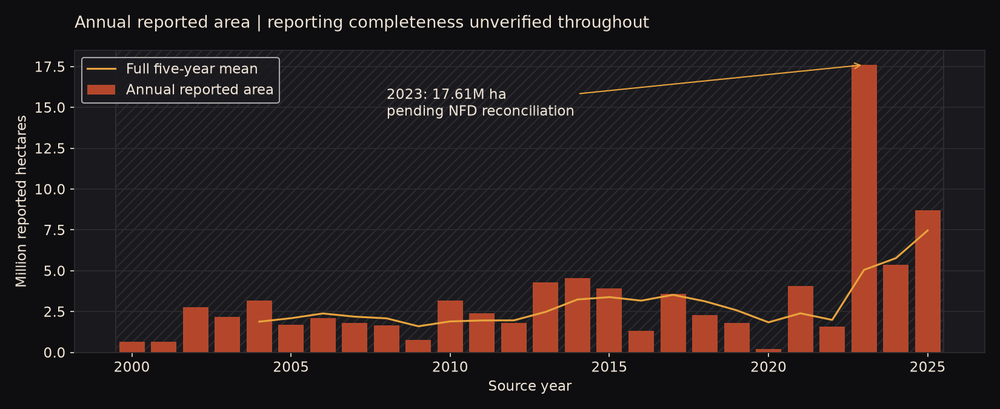

# Canada wildfire seasonal risk research

I built this project to answer a practical planning question: **when do agencies record the most fires, and when do a few large events drive most of the area?** I used the Canadian National Fire Database (CNFDB) point records for 2000–2025. The analysis covers 168,276 records from a fixed set of 12 reporting agencies and sums 83.99 million hectares of recorded fire sizes.



## What I found

| Finding | How I would use it |
| --- | --- |
| The largest 3% of records account for **59% to over 99%** of recorded area within individual agencies. | Review large-event capacity by agency. A pooled national threshold can hide substantial differences in local workload. |
| **July** has the most records with a known report month, at **42,235**. | Use July as a starting point for national seasonal planning, then check individual agency calendars before setting staffing or outreach dates. |
| Natural/lightning causes account for **46% of records and 87% of area**. Human causes account for **49% of records and 8% of area**. | Track the frequency of recorded incidents and the scale of large events separately. They answer different planning questions. |
| Mean annual area for 2020–2025 falls from **6.26 million ha** to **3.99 million ha** when 2023 is removed. | Compare ordinary-year and extreme-year capacity needs. The periods are unequal and reporting changes limit the comparison. |

Agencies record small fires differently. I checked how often each agency records exactly 0, 0.01, and 0.1 ha before comparing typical sizes. Counts refer to database records. Area sums reported sizes and can include overlapping land. The analysis describes historical reporting and provides no forecast of seasonal fire probability.

## How I built it

| Tool | Role in the project |
| --- | --- |
| **Python** | Profiled the source data, preserved exclusion flags, independently checked the SQL results, and produced the notebooks and charts. |
| **SQL / SQLite** | Built the fact and dimension tables and calculated annual totals, seasonal counts, cause shares, and recording checks. |
| **Power BI Desktop** | Built nine report pages, including Executive Summary, Concentration, Trust, Change, Cause, and Northwest Territories response classification. |
| **Excel** | Packaged summary tables and denominator checks for spreadsheet review. |

Open the [Power BI project](dashboard/Canada%20Wildfire.pbip) in Desktop after cloning or downloading the repository. Keep the two project folders beside the `.pbip` file. On the first open, select **Refresh now** if Desktop prompts you to load the embedded summaries. The Executive Summary places a Canadian area map beside annual, monthly and cause charts. The map is a fixed view of rounded coordinate cells across the analysis window. The separate Map page ranks those cells. Record-level slicers and drill-through remain outstanding. [Build guide](powerbi/BUILD_GUIDE.md)

The Executive Summary layout draws on the [SAS Visual Analytics wildfire dashboard](https://communities.sas.com/t5/SAS-Visual-Analytics-Gallery/Fighting-the-Amazon-forest-fires-with-advanced-analytics/ta-p/784221). The Canadian boundary layer comes from [Natural Earth](https://www.naturalearthdata.com/about/terms-of-use/).

Start with the [data quality notebook](notebooks/01_data_quality_and_coverage.ipynb), then read the [burden analysis](notebooks/02_burden_patterns.ipynb). The [Excel workbook](Canada_Wildfire_Review.xlsx) provides the main figures in tables.

## Scope and validation

I used a fixed reporting-agency scope and excluded Prince Edward Island from the main window because its documented coverage starts later. Reporting agencies and geographic jurisdictions are distinct. The Northwest Territories view reports response classifications and includes unknown classifications in its denominators.

The full 2023 source-year count and area rounded to whole hectares match the 2025 annual report's published national table. The project's narrower scope excludes seven Prince Edward Island records and five Ontario records flagged as prescribed fires for that year. **Jurisdiction-by-year NFD reconciliation is pending.** [Reconciliation notes](docs/reconciliation_report.md)

## Reproduce the analysis

Set up Python with `python -m pip install -r requirements.txt`. From the repository root, run these commands in order:

```text
python -m src.download_data
python -m src.prepare_cnfdb
python -m src.load_warehouse
python -m src.reconcile
make analysis
python -m src.export_powerbi
python -m pytest tests -q
```

On Windows without `make`, run the Python commands under `analysis` in the [Makefile](Makefile). The downloader expects the pinned release in [source_versions.csv](data/source_versions.csv) and verifies its SHA-256. If the provider replaces the current archive, place the matching pinned extract in `data/raw/` before running preparation. Raw inputs, generated row-level exports and the local database are excluded from Git.

The combined [Colab notebook](notebooks/03_colab_research_review.ipynb) contains saved outputs. Its interactive runtime path requires the separate review bundle with the built database and figures.

## Source and attribution

Canadian Forest Service. *Canadian National Fire Database: Agency Fire Data*. Natural Resources Canada, Canadian Forest Service, Northern Forestry Centre. Contains information licensed under the [Open Government Licence – Canada](https://open.canada.ca/en/open-government-licence-canada). [Source directory](https://cwfis.cfs.nrcan.gc.ca/downloads/nfdb/fire_pnt/current_version/) · [Data and reuse notes](docs/data_sources_and_licences.md)
