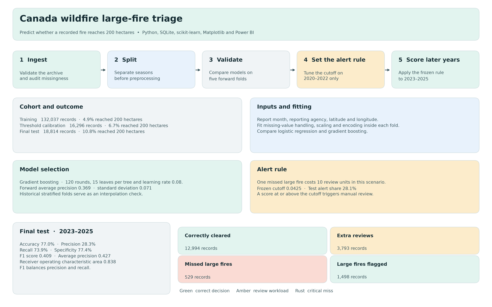

# Can we flag recorded Canadian wildfires that reach 200 hectares?


A wildfire team has limited time for manual review. I tested whether the month, reporting agency and recorded location could help prioritize **already recorded fires** that ultimately reached **200 hectares**. A missed large fire carries the greater cost in this study. The practical question is how many extra reviews a team would take on to miss fewer large fires.



[Scalable Vector Graphics version](assets/pipeline_workflow.svg) · [Power BI handoff](POWER_BI.md) · [Full evaluation results](results/evaluation.json)

## Situation, Task, Action, Result

**Situation.** The Canadian National Fire Database (CNFDB) contains historical agency reports. My companion dashboard describes recorded fire burden from 12 agencies between 2000 and 2025. This study asks a separate question about prioritizing review after a fire enters the reporting system.

**Task.** Build a binary classifier where **1** means final recorded size was at least 200 hectares and **0** means it was below 200 hectares. Each row is an eligible database record. I used the 200-hectare cutoff as the study's operational definition of a large fire.

**Action.** I audited the warehouse, excluded 1,129 records flagged for ambiguous repeated source identifiers, and split the remaining 167,147 records by year before fitting any preprocessing. The model used month, reporting agency, latitude and longitude. I left final area, response classification, cause, containment dates, fire identifiers and year out of the predictors. I compared logistic regression and histogram-based gradient boosting, then used a separate calibration window to choose the alert cutoff. A constant-score reference puts the final ranking performance in context.

**Result.** Gradient boosting had the stronger average precision across forward-year validation folds. On the final test seasons, it flagged **1,498 of 2,027 large fires** and missed **529**. It sent **5,291 of 18,814 records** for review, including **3,793** fires that ended below 200 hectares.

## How I kept the evaluation separate

| Stage | Years | Records | Reached 200 hectares |
| --- | --- | ---: | ---: |
| Training and model selection | 2000–2019 | 132,037 | 6,446 (4.88%) |
| Decision threshold calibration | 2020–2022 | 16,296 | 1,089 (6.68%) |
| Final test | 2023–2025 | 18,814 | 2,027 (10.77%) |

The code fits the median fill for missing coordinates, scaling and categorical encoding inside each fold. Missing report months get an explicit category. The integrity report records missing values and fields with zero variance by split. The training set had 111 missing coordinate pairs, 3,129 missing months and zero constant predictor fields.

Five expanding-window folds simulate scoring later seasons. The first model trains through 2009 and validates on 2010–2011. The remaining folds each extend training by two years and validate on the next two years through 2019. A separate stratified five-fold check preserves class balance inside the training era and measures interpolation stability. Only the forward folds determine model selection.

| Candidate | Forward average precision, mean ± standard deviation | Stratified average precision, mean ± standard deviation |
| --- | ---: | ---: |
| Logistic regression | 0.285 ± 0.058 | 0.264 ± 0.007 |
| Gradient boosting | 0.369 ± 0.071 | 0.374 ± 0.016 |

## Performance on the held-out seasons

| Metric | Value | Operational interpretation |
| --- | ---: | --- |
| Accuracy | 77.03% | Share of all records classified correctly. Clearing every record would score 89.23% and miss every large fire. |
| Precision | 28.31% | Share of alerts that reached 200 hectares. |
| Recall, also called sensitivity | 73.90% | Share of actual large fires flagged. |
| Specificity | 77.41% | Share of fires below 200 hectares cleared. |
| F1 score | 0.409 | Harmonic mean of precision and recall. |
| Area under the receiver operating characteristic curve | 0.838 | How well scores rank large fires above smaller fires across cutoffs. |
| Average precision | 0.427 | Summary of precision across recall levels. A constant-score reference yields 0.108 on this test set. |
| Alert share | 28.12% | Share of all records sent for manual review. |

| Actual outcome | Cleared | Flagged for review |
| --- | ---: | ---: |
| Below 200 hectares | 12,994 correctly cleared | 3,793 extra reviews |
| Reached 200 hectares | **529 missed large fires** | 1,498 correctly flagged |

Recall was **72.75% in 2023**, **75.05% in 2024** and **74.86% in 2025**. The selected annual totals in the companion dashboard remain pending National Forestry Database reconciliation for 2023.

## Asymmetric error and decision boundary stress test

For the main scenario I assigned a missed large fire 10 review-cost units and an extra review one unit. This is a stated planning assumption. I evaluated every distinct calibration score and the option to alert nobody. I froze the cost-minimizing cutoff of **0.0424645** before evaluating the test seasons. A record at or above that score gets flagged. The score is a ranking output and its probability calibration was outside this study.

| Rule chosen before testing | Recall | Missed large fires | Extra reviews | Share reviewed |
| --- | ---: | ---: | ---: | ---: |
| Default cutoff of 0.50 | 4.00% | 1,946 | 45 | 0.67% |
| Miss costs 2 times as much | 29.35% | 1,432 | 454 | 5.58% |
| Miss costs 5 times as much | 63.05% | 749 | 2,203 | 18.50% |
| **Miss costs 10 times as much** | **73.90%** | **529** | **3,793** | **28.12%** |
| Miss costs 20 times as much | 80.61% | 393 | 4,932 | 34.90% |

Compared with the default cutoff, the main rule missed **1,417 fewer** large fires and added **3,748** extra reviews. The higher-cost scenario caught another **136** large fires at the expense of **1,139** more extra reviews. The held-out results describe these trade-offs. Any new cutoff chosen from this comparison needs a new untouched test window. The alert-all reference had zero misses on the test set and would have sent all 18,814 records for review. This study cannot guarantee zero misses in future seasons.

## Scope and limitations

- The archive contains fires already recorded by agencies. This design estimates which of those records eventually cross a size threshold. It does not estimate ignition probability or provide a live incident forecast.
- The archive is a retrospective snapshot. I cannot establish whether the coordinates and report month were available and unchanged at the time an alert would have been issued. The split protects the evaluation from the preprocessing and threshold-selection leaks addressed here, but it cannot verify feature availability or exclude cross-agency copies of the same incident.
- Coordinates and agency can reflect regional reporting practices. Later-season performance within the same agency scope does not establish transfer to new regions. A live pilot needs time-stamped inputs, external validation, and agreed review capacity.
- Final recorded size is subject to agency reporting conventions. A large recorded area is not a direct measure of incident severity, asset exposure or public safety impact.

## Reproduce

Clone the repository and install the dependencies. If the pinned source archive is already available, place it in the clone's data folder as described in the [repository instructions](../README.md).

```sh
git clone https://github.com/mamkon/wildfire-seasonal-risk-research.git
cd wildfire-seasonal-risk-research
python -m pip install -r requirements.txt -r modeling/requirements.txt
python -m src.download_data
python -m src.prepare_cnfdb
python -m src.load_warehouse
python -m modeling.run --miss-cost 10
python -m modeling.diagram
python -m pytest tests/test_modeling.py -q
```

Use `--warehouse` with an existing reviewed SQLite database to skip the three data preparation commands. The workflow writes aggregate JavaScript Object Notation (JSON) and comma-separated values (CSV) files to `modeling/results`. The diagram script renders both a Portable Network Graphics (PNG) image at 300 dots per inch and a scalable vector version from those results. The Power BI handoff uses the aggregate results for a separate review page. Power BI is Microsoft's business intelligence reporting tool.

## Sources

- [Canadian National Fire Database agency fire data](https://cwfis.cfs.nrcan.gc.ca/downloads/nfdb/fire_pnt/current_version/)
- [Source snapshot and licensing notes](../docs/data_sources_and_licences.md)
- [scikit-learn guidance on preprocessing and leakage](https://scikit-learn.org/stable/common_pitfalls.html)
- [scikit-learn guidance on decision thresholds](https://scikit-learn.org/stable/modules/classification_threshold.html)

## Agency-by-month baseline

I estimated large-fire rates by reporting agency and month using **2000–2019 records only**. Missing months form a separate group. Unseen combinations fall back to the agency rate, then the overall training rate. The 2023–2025 records were used to score performance.

| Method | Held-out average precision | Reviews | Large fires flagged | Recall |
| --- | ---: | ---: | ---: | ---: |
| Agency-by-month lookup | 0.293048 | 5,291 | 1,334 | 65.81% |
| Gradient boosting, original 10× policy | 0.426869 | 5,291 | 1,498 | 73.90% |

At 28.12% review coverage, gradient boosting flagged 164 more large fires. The lookup flagged 89% as many. This retrospective comparison sets the review count to the model's observed workload. At the baseline cutoff, 372 records tied for 210 slots. Reporting year and warehouse row key broke ties without using outcomes. A uniform random tie-break would flag about 1,329 large fires on average.

The script calculates average precision from the held-out baseline score groups. The 2× model policy's 0.293537 recall in the policy CSV is a separate calculation. The baseline ran on a rebuilt SQLite warehouse (SHA-256 `a04f210a...`), while the model benchmark comes from the original committed evaluation (`fd79b03a...`). The held-out record and large-fire counts agree across builds (18,814 and 2,027); row-level equivalence has not been verified.

```sh
python -m modeling.agency_month_baseline --warehouse data/warehouse/wildfire.db --output modeling/results/agency_month_baseline.json
```

[Baseline script](agency_month_baseline.py) · [Result](results/agency_month_baseline.json)
